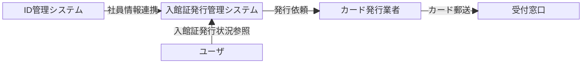

# 要件定義書

## 1. 業務概要

社員が入社すると、社員情報がID管理システムへ登録され、本システムへ連携される。
本システムは連携された社員情報をもとに入館証の発行対象を管理し、カード発行業者へ入館証の発行を依頼する。
カード発行業者は依頼内容をもとに入館証を発行し、発行された入館証は所定の受付窓口へ郵送される。

本システムでは、社員情報の受領からカード発行業者への発行依頼までをシステム化し、以下を実現する。

- 入館証発行対象の一元管理
- 入館証番号の採番
- カード発行業者への入館証発行依頼
- 入館証発行依頼状況画面の参照

カード発行業者によるカードの物理発行、郵送および受付窓口での受け渡しは本システムの対象外とする。

## 2. システム概要

本システムは、ID管理システムから社員情報を受け取り、入館証の発行対象を管理し、カード発行業者へ入館証発行依頼を行う。  
また、ユーザは入館証発行依頼の処理状況を画面より参照できる。

具体的なAWSサービス、通信方式、ファイル形式、ネットワーク構成等の実現方式は基本設計以降で定義する。

## 3. 対象範囲

### 3.1 対象

- ID管理システムからの社員情報受付
- 入館証番号の採番
- 入館証発行対象の管理
- カード発行業者への入館証発行依頼
- 入館証発行依頼状況の管理
- 入館証発行依頼状況の参照画面

### 3.2 対象外

- 入館証発行依頼完了後の、カード発行業者による業務処理
- 入館証の物理的な発行
- 入館証の郵送・受け渡し
- 入館証発行依頼状況の参照画面の認証・認可およびユーザ管理
- カード発行業者からの入館証発行完了結果の受領・反映
- 氏名変更に伴う入館証情報の変更・再発行
- 退職に伴う入館証の失効・返却管理
- 休職・復職に伴う入館証の一時停止・利用再開
- 入館証の有効期限管理および更新
- 破損・紛失・盗難に伴う入館証の失効・再発行
- 入館証ごとの入退館権限の設定・変更・失効
- 入館証を利用した複合機等、他設備・サービスの利用権限管理

本ポートフォリオでは新規入社に伴う入館証発行業務を対象とし、AWSアーキテクチャ、外部システム連携、IaC、CI/CD、監視・障害対応の設計・実装に範囲を限定する。

## 4. 機能要件

### 4.1 社員情報受付

- ID管理システムから連携された社員情報を受け付けられること。
- 受け付けた社員情報を入館証発行対象として管理できること。
- 社員番号は一意であることを前提とし、社員番号をキーとして同一社員の入館証発行対象を重複登録しないこと。

### 4.2 入館証発行対象管理

- 入館証の発行対象と入館証発行依頼状況を管理できること。
- 発行依頼予定の入館証に一意な入館証番号を採番できること。番号の重複・再利用は許容せず、欠番は許容する。
- ユーザが入館証発行依頼状況を画面から参照できること。

### 4.3 入館証発行依頼

- 入館証発行対象の情報をもとにカード発行業者へ入館証発行依頼ができること。

## 5. 外部連携要件

- ID管理システムから社員情報が随時APIで本システムへ連携できること。
- 入館証発行に必要な情報を、ファイル転送による定期連携でカード発行業者へ連携できること。
- カード発行業者が入館証発行依頼を受領した後の、依頼受付可否やカード発行結果は連携対象外とする。

具体的な連携方式、データ形式および通信方式は基本設計以降で定義する。

## 6. 異常系・復旧要件

- 処理途中で障害が発生した場合、処理状況を確認して再実行または復旧できること。
- 外部連携が失敗した場合、対象データを失わず再送できること。
- 自動復旧できない異常について、保守担当者が原因を確認できる情報を残すこと。

## 7. 非機能要件

### 7.1 性能

- 具体的な処理量、リクエスト数、同時ユーザ数は要件対象外とする。

### 7.2 可用性・信頼性

- 24時間365日のサービス提供を前提とすること。
- 単一のアプリケーション実行基盤またはDBインスタンスに障害が発生した場合でも、業務を継続できること。
- 東京リージョン内の単一AZに障害が発生した場合でも、別AZのリソースを利用して業務を継続できること。
- 東京リージョン障害時の業務継続は対象外とする。
- アプリケーション更新、バックアップおよび通常のメンテナンス時においても、原則としてサービス停止を必要としないこと。

### 7.3 セキュリティ・監査

- 通信および保存データについて必要な保護を行うこと。画面のHTTPS化は対象外とする。
- 必要なログを指定期間保存すること。
- 脆弱性対策および不正アクセス対策を行うこと。

### 7.4 運用・監視

- 具体的なRPO・RTOは要件対象外とする。
- 処理状態を確認でき、対応が必要な異常を検知・保守担当者へ通知できること。

### 7.5 コスト

- 必要な機能要件および非機能要件を満たした上で、AWS利用料金を抑制できる構成とすること。
- 利用状況およびAWS利用料金を確認し、必要に応じて構成や設定を見直してコスト削減を行うこと。
