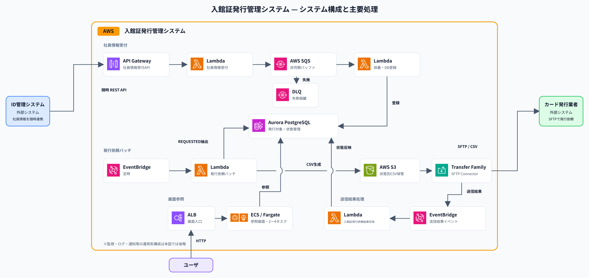
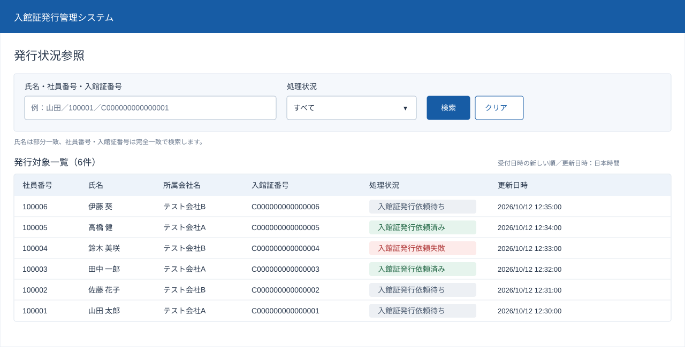

# 基本設計概要

## 1. システム構成

本システムは、ID管理システムから社員情報を受け付け、入館証番号を採番し、日次でカード発行業者へ入館証発行依頼CSVを送信する。ユーザはWeb画面で入館証発行依頼状況を参照する。

AWSのマネージドサービスを組み合わせ、社員情報の非同期処理、ファイル連携、処理状況管理、障害監視を実現する。連携完了の範囲はSFTP転送完了までとし、入館証の物理発行・郵送は対象外とする。

## 2. 画面概要

入館証発行依頼状況を確認する参照専用Web画面を設計・開発する。PCを中心にスマートフォンでの閲覧にも対応し、社員番号・氏名・所属会社名・入館証番号・処理状況・更新日時を一覧表示する。

画面では、氏名の部分一致検索、社員番号・入館証番号の完全一致検索、および処理状況による絞り込みを提供する。データ取得失敗時はエラーメッセージを表示して再操作を促す。

画面からの登録・訂正・再送は行わず、画面認証・認可は対象外とする。上図は画面モックの表示例であり、掲載データはテスト用である。

詳細：[画面基本設計](04_画面基本設計.md) ／ [操作確認用画面モック](41_画面モック/badge-status-mock.html)

## 3. システム境界

| 主体 | 責任 |
| --- | --- |
| ID管理システム | 社員番号・氏名・所属会社名をAPI連携 |
| 本システム | 受付・採番・対象管理・CSV作成／転送・結果反映・状況参照 |
| カード発行業者 | CSV受領・入館証の物理発行・郵送 |
| 保守担当者 | 障害メール確認・調査・復旧・環境変更 |

## 4. 主要機能

### 4.1 社員情報受付・登録

ID管理システムから、HTTPSのREST API（JSON形式）で社員情報を受け付ける。

API Gateway、Lambda、SQSを利用して受付とDB登録を非同期に処理し、Aurora PostgreSQLに社員情報と採番した入館証番号を登録する。社員番号による重複登録防止と、処理失敗時の再試行・DLQへの隔離を行う。

### 4.2 入館証発行依頼・結果反映

EventBridge SchedulerとLambdaを利用して日次処理を実行し、発行依頼対象からCSVを作成してS3に保存する。AWS Transfer FamilyのSFTP Connectorを利用してカード発行業者へCSVを送信する。

送信結果はEventBridgeとLambdaで取得し、Aurora PostgreSQLの処理状況とS3上のファイル配置に反映する。送信に失敗したCSVは保持し、保守担当者による再送を可能にする。

### 4.3 入館証発行依頼状況参照

ALBとECS / Fargateを利用して、入館証発行依頼状況を参照するWeb画面を提供する。

Aurora PostgreSQLのReaderから情報を取得し、社員情報や入館証発行依頼状況の一覧表示・検索を可能にする。

## 5. 主要コンポーネント

| 機能 | サービス・コンポーネント |
| --- | --- |
| 社員情報受付 | API Gateway、社員情報受付Lambda |
| 社員情報登録 | SQS、社員情報登録Lambda、DLQ、Aurora PostgreSQL |
| 入館証発行依頼 | EventBridge Scheduler、入館証発行依頼Lambda、S3、AWS Transfer Family |
| 入館証発行依頼結果反映 | EventBridge、入館証発行依頼結果反映Lambda、失敗保存用SQS |
| 状況参照 | ALB、ECS / Fargate、Aurora PostgreSQL Reader |
| 監視・通知・費用管理 | CloudWatch、SNS、AWS Budgets |
| セキュリティ | IAM、Secrets Manager、Config、GuardDuty、Inspector、Security Hub CSPM |
| 構築・変更管理 | Terraform、GitHub Actions、ECR |

## 6. 基盤・非機能・運用概要

| 分野 | 基本方式 |
| --- | --- |
| 可用性 | ALB・ECS / Fargateを2AZに配置し、Aurora PostgreSQLは別AZのWriter・Readerによる自動フェイルオーバーを利用する |
| 性能・拡張性 | ECS Service Auto ScalingによってWebタスク数を自動調整し、SQSによって受付負荷を吸収する |
| ネットワーク | Public SubnetとPrivate Subnetを分離し、必要なAWSサービスにはVPC Endpoint経由で接続する |
| セキュリティ | IAMによるアクセス制御、通信・保存データの暗号化、Secrets Managerによる秘密情報管理を実施する。Config・GuardDuty・Inspector・Security Hub CSPMを利用して構成評価、脅威検知、脆弱性検査、所見管理を行う |
| バックアップ | Auroraの自動バックアップとS3のバージョニングによってデータを保護する |
| 監視・障害対応 | CloudWatchで業務処理・AWSリソースを監視し、異常やセキュリティ上の所見をSNS等でメール通知する。保守担当者が調査・復旧を行う |
| 構築・変更管理 | TerraformでAWS環境をコード管理し、GitHub ActionsでCIおよび環境の作成・変更・削除を実行する |
| 費用管理 | AWS Budgetsによる費用監視と、一時環境の不要時の削除によって費用を管理する |

