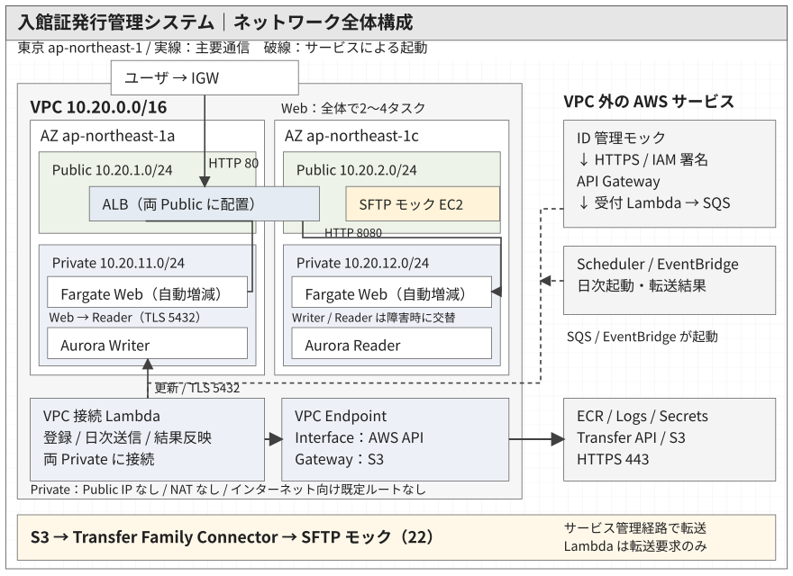

# 基盤・非機能基本設計

本システムは、東京リージョンの2AZ構成、非同期処理、非公開ネットワークを基本とし、可用性・セキュリティ・運用性を確保する。単一タスク・DBインスタンス・AZの障害には自動復旧または切替で対応し、外部連携の失敗には再試行と手動復旧で対応する。

## 1. 配置・ネットワーク構成

Webの公開入口と業務処理・データの配置先を分離する。ALBは2つのPublic Subnet、ECS / Fargate・Aurora・DB接続Lambdaは2つのPrivate Subnetを使用する。

通信経路の詳細は[主要通信経路図](51_画像/ネットワーク通信経路図.svg)を参照する。

| 配置 | 主なリソース・役割 |
| --- | --- |
| Public Subnet（2AZ） | Web公開用ALB。カード発行業者のEC2は片側のAZに配置 |
| Private Subnet（2AZ） | ECS / Fargate、Aurora、DB接続Lambda、再送Lambda、DB変更用タスク、Interface VPC Endpoint |
| VPC外のAWSサービス | API Gateway、受付Lambda、SQS、S3、EventBridge、EventBridge Scheduler、Transfer Family Connector、ID管理システムのLambda |

ALBは両AZにまたがる単一のロードバランサとする。VPC接続するLambdaは両Private Subnetを指定する。カード発行業者は本システムのAZ冗長化対象外とする。

Private Subnetにはインターネット向けのデフォルトルートおよびNAT Gatewayを設けない。AWSサービスへの必要な通信はVPC Endpointを経由させ、汎用的なインターネット送信経路を持たせない。Interface VPC Endpointの利用料金は構成費用に含める。

### 1.1 主要通信経路

| 通信元 → 通信先 | 通信方式・アクセス制御 |
| --- | --- |
| ユーザ → ALB → Webタスク | HTTP。Webタスクへの接続はALBのSGからのみ許可 |
| Webタスク → Aurora Reader | PostgreSQL/TLS、参照専用DB権限 |
| 登録・発行依頼・結果反映Lambda → Aurora Writer | PostgreSQL/TLS、処理用DB権限 |
| DB変更用タスク → Aurora Writer | PostgreSQL/TLS、構築・変更用DB権限 |
| VPC内処理 → AWSサービス | Interface VPC Endpoint経由のHTTPS。SG・Endpointポリシー・IAMで制御 |
| VPC内処理 → S3 | S3 Gateway Endpoint経由のHTTPS |
| ID管理システム → API Gateway → 受付Lambda → SQS | HTTPS、IAM署名によるAPI認証。受付LambdaはDBに接続しない |
| Transfer Family Connector → カード発行業者 | SFTP鍵認証、送信元IP制限、対向ホスト鍵検証 |
| SQS・EventBridge → Lambda | AWSサービスからのイベント起動。外部向け受信ポートは不要 |
| GitHub Actions → AWS API | OIDCによる一時的な認証情報を使用 |

Transfer Family ConnectorはAWS管理の送信経路からSFTP接続する。業務LambdaからTransfer Family APIを呼び出す経路とは分離する。

### 1.2 VPC Endpoint

| Endpoint | 主な用途 |
| --- | --- |
| ECR API・Docker Registry（Interface） | Fargateのコンテナイメージ取得 |
| CloudWatch Logs（Interface） | Fargateのログ送信 |
| Secrets Manager（Interface） | DB認証情報の取得 |
| Transfer Family（Interface） | Lambdaからのファイル転送要求 |
| S3（Gateway） | コンテナイメージレイヤー取得、業務CSVの保存・操作 |

Interface VPC Endpointは両AZに配置してPrivate DNSを有効化する。S3 Gateway EndpointはPrivate Subnetのルートテーブルに関連付ける。詳細な通信許可と設定値は[VPC詳細設計](../03_詳細設計/01_基盤/01_AWS_VPC.md)に定める。

## 2. 可用性・信頼性

単一タスク・DBインスタンス・AZの障害時は、自動復旧・フェイルオーバー・再試行によりサービスの継続を図る。切替中の一時的なエラーは許容する。

| 対象 | 基本方式 |
| --- | --- |
| Web | ALBとECS / Fargateを2AZに配置。ヘルスチェック、不健全タスクの置換、ローリング更新を使用 |
| DB | Aurora PostgreSQLのWriter・Readerを別AZに配置し、自動フェイルオーバーを使用 |
| 受付・登録 | SQSで受付とDB登録を分離。処理失敗時は再試行し、継続失敗をDLQへ隔離 |
| AWSサービス接続 | Interface VPC Endpointを複数AZに配置 |

ALBおよびコンテナのヘルスチェックには、DB接続を行わない`/health`を使用する。DBを含む疎通確認には`/ready`を使用し、Webタスクの正常性と業務処理の正常性を分けて判定する。AuroraのReaderはWriter障害時の昇格先とする。

リージョン障害からの復旧およびRPO/RTOの数値保証は対象外とする。

## 3. 性能・拡張性

| 対象 | 基本方式 |
| --- | --- |
| Web | ECS Service Auto Scalingのターゲット追跡により、負荷に応じて2～4タスクへ自動増減 |
| DB参照 | 更新処理はWriter、画面参照はReaderに接続して参照負荷を分離 |
| DB接続 | ECS・LambdaからAuroraへ直接接続。同時実行数と接続再利用によって接続数を制御 |
| 非同期処理 | SQSによってAPI受付とDB登録を分離し、受付時の負荷変動を吸収 |

Webのスケーリング指標にはALBのターゲット当たりリクエスト数を使用し、目標を1タスク当たり10リクエスト／分、タスク数を最小2・最大4とする。目標値は自動増減の制御値であり、処理能力の上限や性能保証値を示すものではない。詳細は[ECS詳細設計](../03_詳細設計/01_基盤/07_AWS_ECS_Fargate.md)に定める。

Readerの反映遅延により、画面表示が更新直後の状態と一時的に一致しないことを許容する。具体的な処理量・応答性能の数値保証は対象外とする。

## 4. セキュリティ

| 分野 | 基本方針 |
| --- | --- |
| 公開範囲 | 公開入口をALB・API Gatewayに限定し、ECS・Aurora・業務Lambdaは非公開ネットワークに配置 |
| 通信・保存 | APIはHTTPS、ファイル転送はSFTP、DB接続はTLSと証明書検証を使用。Aurora・S3・SQS・ログを保存時暗号化 |
| 認証・認可 | APIはIAM署名で認証し、AWS実行ロールとDBユーザ権限を用途別に分離 |
| 秘密情報 | Secrets Managerで認証情報を管理。秘密鍵・パスワードをソースコードやログに記録せず、Terraform stateを保護 |
| アプリケーション | 入力検証、SQLパラメータ化、HTMLエスケープを実施 |
| 脅威検知 | GuardDutyで不審な操作・通信を検知 |
| 脆弱性管理 | InspectorでECR・Lambdaの既知脆弱性を検査 |
| 構成評価 | Configで設定を記録・評価し、Security Hub CSPMで検出結果を集約・確認 |
| CI/CD | GitHub ActionsからOIDCでAWSの一時的な実行権限を取得 |

構成評価はS3の公開設定、DBの公開・暗号化設定、SGの不要な開放などを対象とする。検出した問題は[運用監視基本設計](07_運用監視基本設計.md)に基づき通知・対処する。

画面のHTTPS化・ユーザ認証・認可、WAF、自動隔離・自動修復、複数リージョンを用いた災害対策は対象外とする。

## 5. バックアップ・復元

DBのMulti-AZ構成によるフェイルオーバーはインスタンス・AZ障害への対応とし、バックアップからの復元は誤削除・誤更新等の論理障害への対応として区別する。

| 対象 | 基本方式 |
| --- | --- |
| Aurora PostgreSQL | 自動バックアップを取得し、7日間保持。必要に応じて過去時点へ復元 |
| 業務CSV（S3） | Versioningで誤更新・誤削除に備える。現行版は環境存続中保持し、非現行版は30日間保持 |
| 復元後の整合性 | DB、S3上のCSV、外部送信結果を照合し、必要な訂正・再処理を手動で判断 |

Auroraの過去時点復元は別クラスターへの復元を基本とし、復元データとS3・外部送信状況の整合性を確認して業務を再開する。CloudWatch LogsやDLQ等の記録は原因調査・再処理の補助として利用し、DBバックアップの代替とはしない。

費用抑制のため一時環境を意図的に削除する場合は、最終DBスナップショットを取得せず、業務用S3データ・ログも削除する。削除後の業務データ復元・引継ぎは対象外とし、稼働中の障害復旧と区別する。

監視・通知、具体的な復旧判断と保守手順、構築・更新・切り戻しおよび費用管理は[運用監視基本設計](07_運用監視基本設計.md)と運用設計・手順書に定める。
