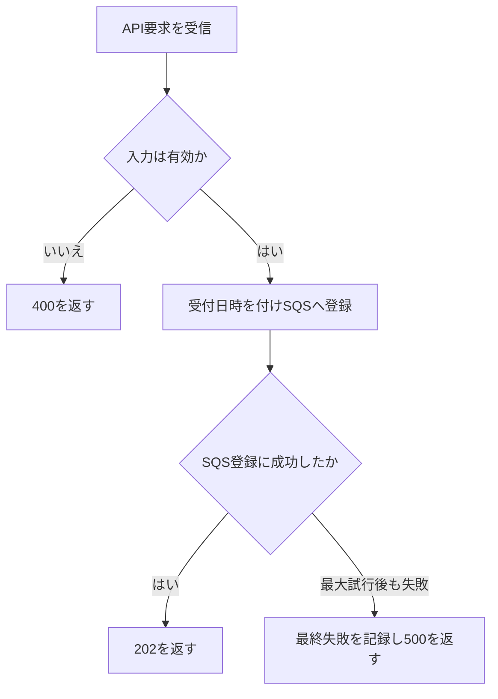
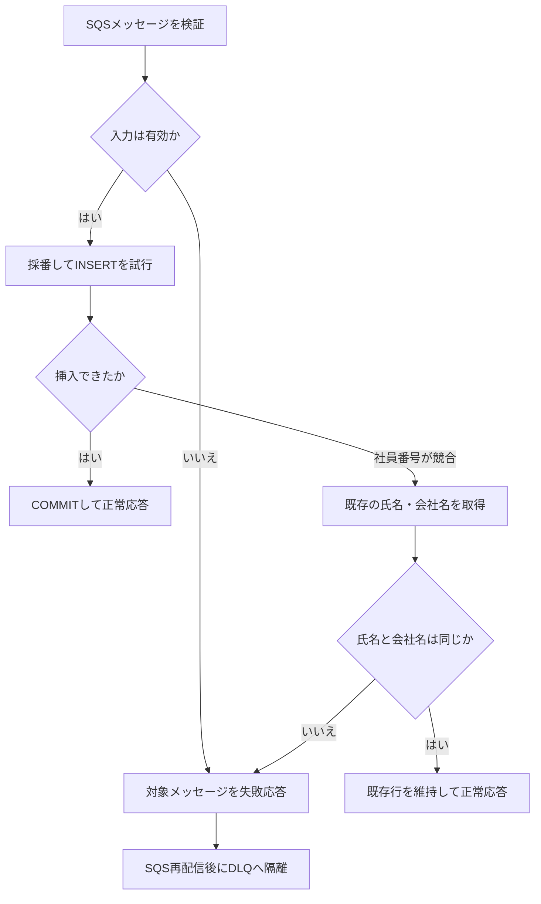
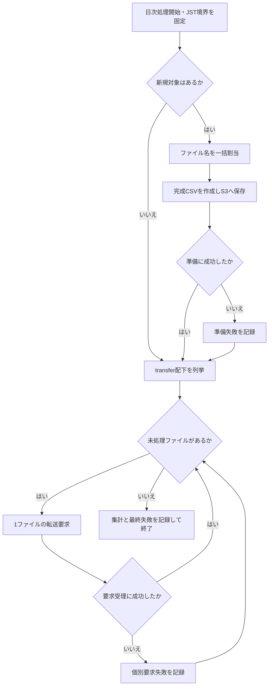
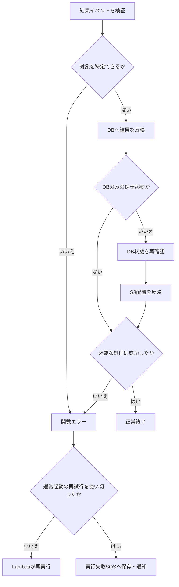

# Lambda処理仕様

## 1. 共通仕様

本書は業務Lambdaの処理仕様を定義する。基盤設定は[04_AWS_Lambda](../01_基盤/04_AWS_Lambda.md)、DB・CSVは[02_DB・ファイル詳細設計](02_DB・ファイル詳細設計.md)、保守起動は[03_保守ツール処理仕様](../03_構築保守/03_保守ツール処理仕様.md)を参照する。

| 項目 | 処理 |
| --- | --- |
| 言語・handler | Python 3.13、各ZIPの`app.lambda_handler(event, context)` |
| DB | psycopg、TLS verify-full、SQLは値をバインド。登録・割当は各1トランザクション、結果反映は第5.3節の2段階 |
| SDK | read系はstandard、`total_max_attempts=3`、`connect_timeout=3秒`、`read_timeout=5秒` |
| 更新SDK | L01 SendMessageのみ`connect_timeout=1秒`、`read_timeout=2秒`、`total_max_attempts=3`。S3更新・Transfer要求は1回実行し、処理単位の再実行で復旧 |
| DB再試行 | 関数内でSQL再実行ループを持たず、呼出し方式側の再試行に任せる |
| ログ | 例外種別、安全なerror_code、対象識別子を記録。社員情報、SQLパラメータ、生AWS応答全文は出力しない |
| 接続後処理 | 例外時rollback、成功時commit、破断時close。正常なアイドル接続は再利用 |
| 時刻 | aware datetime、業務時刻はJST、文字列はISO8601 `+09:00` |
| 残り時間 | L03/L05は各ファイル処理前に残り15秒を確認し、不足時は`TIME_BUDGET`として終了 |

日次点検、自動全件再送、CSV自動復元は実装しない。

## 2. L01 社員情報受付

### 2.1 処理フロー



### 2.2 処理仕様

| 項目 | 仕様 |
| --- | --- |
| 入力 | API Gateway HTTP API payload 2.0 |
| 出力 | Lambda proxy応答 |
| 対象 | `POST /employees`、1人分JSON |
| DB接続 | なし |

| 順 | 処理 | 分岐・失敗時 |
| --- | --- | --- |
| 1 | `isBase64Encoded`なら厳密デコードし、UTF-8本文サイズを確認 | 不正・4096 bytes超過は400 |
| 2 | 重複キーを拒否してJSON解析し、3業務項目を検証 | 不正文字・不正形式は400。SQSを呼ばない |
| 3 | `received_at=現在JST`、`request_id=requestContext.requestId`を付与 | 本文から日時・識別子を受け付けない |
| 4 | 登録SQSへ`schema_version=1`と受付情報をSendMessage | SDK総試行3回でも失敗なら`FinalFailure`、500 |
| 5 | SendMessage成功を確認して202を返す | DB登録完了は待たない |

SQS送信成功後にAPI応答を受信できない場合でも、同内容の再連携でDB重複を防止する。API GatewayからLambdaへの同期要求全体が自動再実行される前提にはしない。

## 3. L02 社員情報登録

### 3.1 処理フロー



DB接続・SQL失敗も対象メッセージの失敗応答とし、業務エラーとは`error_code`で区別する。

### 3.2 処理仕様

| 項目 | 仕様 |
| --- | --- |
| 入力 | SQS Records、batch size=1 |
| 出力 | `batchItemFailures` |
| 成功 | 新規登録、または同一社員・同内容 |
| 恒久的業務エラー | 同一社員・異内容、入力スキーマ不正 |
| 技術エラー | DB接続、SQL、Secret取得等 |
| エラー後 | 対象メッセージのみ失敗としてSQS redrive |

| 順 | 処理 | 成功条件 |
| --- | --- | --- |
| 1 | Body・`schema_version`・3業務項目・`received_at`を検証 | 受付と同じ規則、日時はoffset付き |
| 2 | Writerへ接続してBEGIN | 既存行の事前SELECTは行わず3へ |
| 3 | `badge_number=英大文字1文字＋数字15桁`を乱数生成し`INSERT ... ON CONFLICT (employee_id) DO NOTHING RETURNING` | 挿入成功ならCOMMIT。競合時は4へ |
| 4 | 社員番号競合時、同一トランザクション内で既存の氏名・会社名をSELECTして比較 | 同内容なら変更せず正常終了 |
| 5 | 異内容ならrollbackし`EMPLOYEE_CONFLICT` | 対象messageIdを失敗応答 |

同内容の再処理では`received_at`、`updated_at`、`badge_number`、`status`、`send_filename`を更新しない。並列INSERTでも主キー制約と再照会で重複行を防ぐ。badge_numberの一意制約違反は技術エラーとしてrollbackし、SQS再試行へ回す。

## 4. L03 入館証発行依頼

### 4.1 処理フロー



SFTP送信完了は本処理内で待機しない。

### 4.2 処理仕様

| 項目 | 仕様 |
| --- | --- |
| 入力 | `{"schema_version":1,"mode":"daily"}` |
| 出力 | `overall`、`assigned_count`、`prepared_file`、`requested_count`、`failed_count`、`not_sent_count` |
| 対象 | `received_at < 当日00:00 JST`、`REQUESTED`、`send_filename IS NULL` |
| 上限 | 1回10000行、CSV 16 MiB、送信要求100ファイル |
| 排他 | 予約同時実行1と、ファイル割当SQLの行ロック |

| 順 | 処理 | 異常時 |
| --- | --- | --- |
| 1 | 起動時点のJST日付から境界時刻を固定 | 処理中に日付境界を変えない |
| 2 | ファイル名を生成し、対象を`received_at・employee_id`順で`FOR UPDATE SKIP LOCKED` | 0件なら新規CSVなしで6へ |
| 3 | 対象全件へ同じ`send_filename`と`updated_at`を設定してCOMMIT | commit前失敗は全件rollback |
| 4 | 対象をemployee_id順でCSV化し、サイズ・SHA-256を算出 | 失敗は割当を維持し`CSV_PREPARE_FAILED` |
| 5 | 完成CSVだけ`transfer/`へ`IfNoneMatch=*`で保存 | 失敗は割当を維持し`CSV_PREPARE_FAILED` |
| 6 | `transfer/`を全ページ列挙し、規定名CSVを名前順に処理 | 一覧取得失敗は`LIST_FAILED` |
| 7 | 1ファイルずつStartFileTransferを実行 | 個別失敗を記録して次へ |
| 8 | 集計して終了 | 捕捉失敗は`FinalFailure` |

上限を超えた未割当レコードは次回対象に残す。16 MiB超過時はファイルを保存せず通知する。ファイル名割当後にCSV生成へ失敗したレコードは新規対象へ戻さず、同一ファイル名で手動復元する。

SFTP完了前にDB statusを変更しない。成功済みファイルが`transfer/`へ残る異常は次回定時実行前に運用で復旧する。転送中判定用の追加テーブルやロックファイルは設けない。

## 5. L04 入館証発行依頼結果反映

### 5.1 処理フロー



保守同期起動の関数エラーは呼出し元へ返し、自動再試行しない。再試行と失敗保存は通常の非同期起動だけに適用する。

### 5.2 入力・正規化

| 入力 | 仕様 |
| --- | --- |
| 通常 | TransferのEventBridgeイベント全体 |
| 保守 | `{"mode":"db_only","event":<元イベント>}`、同期Invoke限定 |
| 成功出力 | `{"ok":true,"filename":"...","db":"OK","s3":"OKまたはSKIPPED"}` |
| 失敗出力 | 関数例外。保守呼出し元は`FunctionError`を確認 |

`source`、`account`、`region`、Connector、`SEND`、`domain=S3`、bucket、S3 key、`detail-type`、`status-code`を検証する。任意のS3パスやSQL条件を保守入力で上書きできない。

### 5.3 DB・S3処理

`SENT`を送信成功の確定状態とする。成功を一度確定したファイルは、後続の失敗結果で`SEND_FAILED`へ戻さない。結果時刻・TransferIdの大小比較、転送試行テーブル、新しい状態カラムは追加しない。

| 順 | 処理 | 分岐 |
| --- | --- | --- |
| 1 | Completed→`SENT`、Failed→`SEND_FAILED`へ正規化 | filename・所有条件を検証 |
| 2 | 第1トランザクションで対象行を社員番号順に`FOR UPDATE` | 対象なしは`DB_TARGET_NOT_FOUND` |
| 3 | 失敗結果かつ対象に`SENT`があれば反映を省略 | DB/S3を変更せず正常終了 |
| 4 | 同一status以外を一括更新してCOMMIT | 後続S3失敗でもDB結果は維持 |
| 5 | `db_only`ならS3を省略。通常起動は第2トランザクションで同じ行を再ロックし状態を確認 | 並行処理で成功確定済みなら失敗側S3操作を省略 |
| 6 | 第2トランザクションのロックを維持してS3配置を実行 | 結果反映の追越しを防止 |
| 7 | S3失敗時は関数失敗 | 第1トランザクションのDB結果は巻き戻さない |
| 8 | 完了または成功後失敗の省略 | `ok=true`。省略時は`ignored_after_success=true`、`s3=SKIPPED` |

DBエラー時はS3操作へ進まない。第2トランザクションだけ`idle_in_transaction_session_timeout=120秒`とし、関数timeout 60秒、通常`lock_timeout=3秒`を維持する。

同じ成功結果の再配信ではS3配置を省略せず、DB=`SENT`・S3未完了から配置を復旧できる。成功確定後の失敗結果は`TransferFailed`を再発報しない。DBで成功確定を判定できない場合は無害とみなさず、通常の再試行・最終失敗処理へ回す。

### 5.4 DB更新SQL

```sql
SELECT employee_id, status
FROM badge.card_requests
WHERE send_filename = %(filename)s
ORDER BY employee_id
FOR UPDATE;
```

入力結果が`SEND_FAILED`で、対象行のいずれかが`SENT`なら更新しない。それ以外では同一statusへの再適用を更新しない。対象件数はSELECT結果で判定するため、UPDATE 0件を異常とはしない。

`event_time`はJSTへ変換する。TransferIdはログ用途のみで、結果の新旧比較には使用しない。

### 5.5 S3移動の再実行

成功時dest=`success/`、失敗時dest=`failed/`とする。

| 状態 | 動作 |
| --- | --- |
| src=dest | 存在確認して正常。コピー・削除なし |
| srcのみ存在 | CopyObject、SHA-256・長さ一致を確認してsrc削除 |
| src・destあり、同内容 | src削除のみ |
| srcなし、destあり | 規定名・sha256 metadataと実データ一致を確認して移動済み成功 |
| src・destなし | `FILE_NOT_FOUND` |
| 内容不一致 | `CONTENT_MISMATCH`。上書き・削除しない |
| 403等で存在確認不能 | `S3_ACCESS_ERROR`。存在なしに読み替えない |

コピー時はsha256 metadataを維持する。

### 5.6 再試行・失敗保存

| 事象 | 結果 |
| --- | --- |
| DB成功・S3失敗 | 次回はDBを同一結果として扱い、S3未完了分を実行 |
| DB反映・状態再確認失敗 | S3変更を保留し、次回DBから再確認 |
| 成功確定後の失敗結果 | DB/S3を変更せず正常終了。再通知しない |
| DB/S3成功後timeout | 次回の冪等処理で完了済みとして収束 |
| 3回とも関数失敗 | Lambda destinationへ元イベントを保存 |
| EventBridge配信不能 | target DLQへ元イベントを保存 |
| 失敗保存不能 | 保存失敗metricで通知 |

Lambda Errorsの1回目では障害メールを送らず、最終失敗保存先へ到達した場合に通知する。

## 6. L05・共通部品

L05の詳細は[03_保守ツール処理仕様](../03_構築保守/03_保守ツール処理仕様.md)を参照する。

| 部品 | 引数 → 戻り値 | 役割 |
| --- | --- | --- |
| `validate_employee` | object → validated dict | 受付・登録の共通業務検証 |
| `get_db_connection` | Secret ARN・host・role → connection | Secret取得・TLS・接続再利用 |
| `make_csv` | ordered rows → bytes・sha256 | 定義済み4列のCSV生成 |
| `normalize_result` | event → filename・src・status・event_time | イベント信頼境界・形式検証 |
| `move_object` | src・dest → OKまたは例外 | 冪等なS3配置変更 |
| `write_log / emit_metric` | 固定スキーマ → stdout | JSON・EMF出力 |

## 7. L03 日次完了記録・未処理確認

日次のCSV準備・転送要求がすべて成功した場合のみ、S3へ`daily/YYYYMMDD.json`をPutする。本文はdate（YYYYMMDD）とcompleted_at（JST）。0件正常も保存する。CSV準備・転送要求・記録保存失敗では完了を確定せず、FinalFailureを記録する。完了記録は転送要求受付を示し、SFTPの最終成功とは分ける。

同じrequest-batch Lambdaが03:00 JSTに`{"schema_version":1,"mode":"check_daily"}`を受ける。余分な項目・boolのschema_versionは拒否する。

1. 当日キーの完了記録を読み、dateが当日と一致することを確認する。欠落・読取不能・不正はDAILY_RECORD_MISSING_OR_UNREADABLE。
2. DBでreceived_at < 当日00:00 JST、status <> SENTの件数を取得する。未割当・割当済REQUESTED・SEND_FAILEDを含む。当日受付を含めない。
3. 1件以上はDAILY_PENDING、DB確認失敗はDAILY_DB_CHECK_FAILEDとして区別する。S3確認失敗でもDB確認を続ける。
4. 正常はok=true、pending_count=0。異常はok=falseとerrorsを返し、Process=daily-checkのFinalFailureを記録する。ログへ件数・固定エラーコードだけを記録する。

完了確認はDB・S3を変更せず、CSV再送も行わない。全件のS3配置・Transfer実績を自動照合するものではない。SENT後のS3配置不備は既存の結果反映失敗監視で扱う。完了確認の再実行は通知の再発を許容する。
