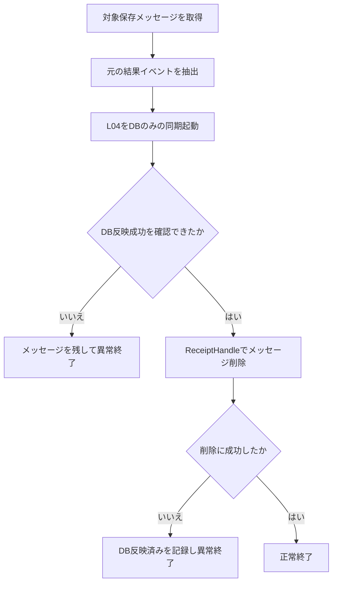

# 保守ツール 処理仕様

本書は業務の復旧処理・保守操作の入出力と動作を定義する。画面に保守ボタンを追加しない。

業務保守専用のGitHub Actionsワークフローは設けない。結果再反映は`maintenance/replay_result.py`を、再送・日次手動実行は既存のLambdaを利用する。

## 1. L05 失敗ファイル全件再送

| 項目 | 仕様 |
| --- | --- |
| 入口 | resend:liveをRequestResponseで同期Invoke。現行3本に専用の保守入口はない |
| 入力 | {"mode":"resend_failed","placement_checked":true} |
| 入力検証 | 上記2項目のみ。確認フラグfalse/欠落なら送信しない |
| 対象 | failed/直下、20の規定名に一致するCSV全件 |
| DB参照 | 行わない |
| S3更新 | 行わない。failed/のまま送信 |
| 出力 | {"ok":true/false,"total":n,"requested":n,"failed":n,"not_sent":n} |
| 正常判定 | FunctionErrorなし、ok=true、failed=0、not_sent=0 |
| 0件 | 正常、requested=0 |

全ページ列挙→名前順→1ファイルずつStartFileTransfer。100ファイル超過は対象を黙って捨てず、超過をnot_sentへ計上して異常結果。時間不足も同様。個別失敗後も他ファイルを続ける。API自動再試行なし。

要求受理後はL04が非同期に結果を反映する。ツールの正常終了はSFTP完了ではない。SFTP失敗はfailedのまま、成功はsuccessへ移動する。配置確認フラグは保守担当者の確認記録であり、DB照合を自動実行するものではない。

## 2. 保存した結果の再反映

### 2.1 入出力

| 項目 | 仕様 |
| --- | --- |
| プログラム | `maintenance/replay_result.py`の共通関数。運用手順書に従い認証済みPython環境で使用 |
| queue_kind | delivery または execution。URLはTerraform outputsから解決 |
| message_id | 対象SQS MessageId（必須） |
| receive | MaxNumberOfMessages=1、WaitTimeSeconds=10、VisibilityTimeout=300 |
| 探索 | 最大20回。SQSはID指定受信不可なので、一致しない受信は削除せず保持 |
| 一致なし | 対象未取得として異常終了。ID不一致を代替対象にしない |
| delivery Body | 元EventBridgeイベント |
| execution Body | JSON実行記録のrequestPayload |
| 許可 | 元イベント全体をL04 validatorで再検証 |

受信の一時的な不可視化は期限で戻る。一致しないメッセージを削除・再送しない。大量キューの汎用探索ツールは作らず、小規模障害の単件復旧に限定する。

### 2.2 処理順序

| 順 | 処理 | 失敗時 |
| --- | --- | --- |
| 1 | queue_kindとmessage_idを検証し、該当キューから対象を受信 | 異常終了、削除しない |
| 2 | 上記Body形式から元イベントを取り出す | 不正JSON/形式不一致なら残す |
| 3 | L04:liveを{"mode":"db_only","event":...}で同期Invoke | 通信失敗・FunctionErrorなら残す |
| 4 | 戻り値ok=true・db=OK・s3=SKIPPED・filename一致を確認 | 1つでも不一致なら残す |
| 5 | 受信したReceiptHandleでDeleteMessage | 削除失敗はツール異常。DB再適用は安全 |

DB再反映でCSVを再送しない。配信失敗・実行失敗ともdb_onlyへ統一し、S3配置は保守担当者が実結果に基づき別途確認・復旧する。DBだけ成功してキュー削除が失敗しても、次回は同じ結果のDB更新を正常扱いにできる。

## 3. 登録DLQ・CSV復元・配置復旧

| 操作 | 仕様 |
| --- | --- |
| 登録DLQ | 原因解消後SQSのredriveで元キューへ戻す。同一社員異内容は原因確認なしに全件redriveしない |
| CSV復元 | 20のSELECT・順序・CSV規則から保守担当者が手動作成し、割当名とSHA-256を照合してtransfer/へ保存 |
| S3配置復旧 | Connectorの実結果・元/先内容を確認しcopy→確認→delete。結果再反映のためCSVを再送しない |
| 過去時点復元 | 復元先DB・利用可能なファイル/ログから個別復旧。汎用自動照合ツールなし |

CSV自動再作成プログラムは作らない。登録DLQ・配置復旧用の独自汎用Lambdaも追加しない。AWSアクセスは共通OIDCロールを使用する設計とし、任意SQLを画面やワークフロー入力から実行できる機能を作らない。

## 4. 結果再反映フロー

S3配置の確認・復旧は別の保守作業として行う。メッセージ削除だけを根拠にS3配置復旧済みとは扱わない。

## 5. 日次手動実行・完了確認

日次手動実行・完了確認が必要な場合の呼出し先は、一時stateのbatch_functionとする。日次SchedulerがDISABLEDでなければ拒否する。dailyは固定入力schema_version=1 / mode=daily、daily-checkはmode=check_dailyを使用する。FunctionError、dailyのoverall != OK、daily-checkのok != trueは異常終了する。日次実行の成功は転送要求受付であり、転送完了は結果反映後に確認する。

