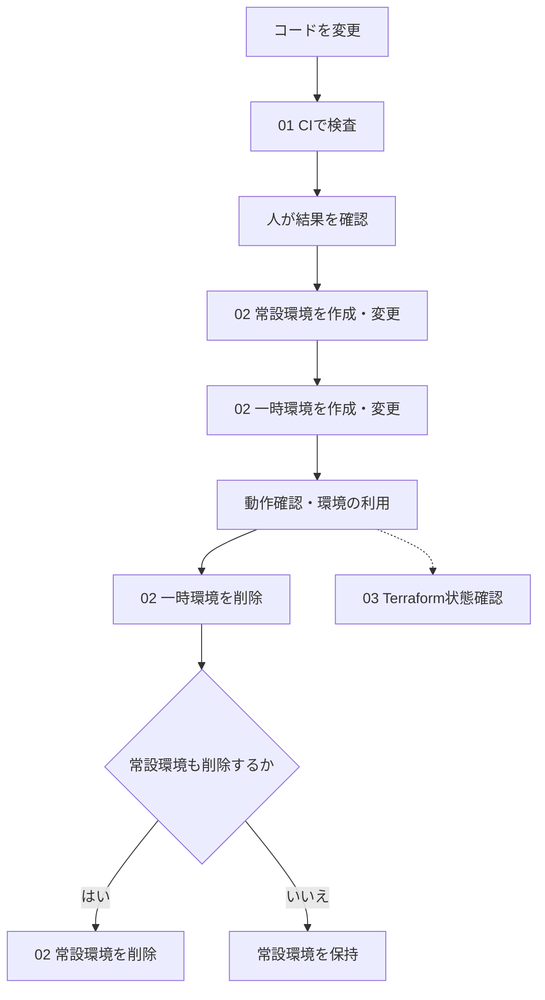

# ワークフロー

ワークフロー概要・プログラム詳細設計・操作手順は[01_ドキュメント](01_ドキュメント/README.md)、実行補助Pythonは[02_資材](02_資材/README.md)に配置する。構築順序が複雑になる理由は、SFTPサーバの作成後に鍵を取得し、DB更新の成功後にWebを適用するなど、Terraformのリソース依存関係の外側にも前後関係があるためである。

## 1. 概要

本システムでは、コードの検査およびAWS環境の作成・変更・削除・状態確認をGitHub Actionsで管理する。これらの処理は、起動条件、実行権限、ジョブおよび処理手順をYAMLで定義した「**ワークフロー**」として構成する。定義ファイルは`.github/workflows/`に配置し、プルリクエストやコードの反映、GitHub Actions画面からの手動操作を契機として起動する。

ワークフローはジョブと、その内部で順次実行されるステップから構成される。本システムではGitHub ActionsのUbuntuランナー上で、コード取得、実行環境の準備、必要に応じたAWS認証、Terraformコマンドの実行などを行う。これにより、作業手順の再現性を確保し、実行履歴とログから結果を追跡できるようにする。

| 用語 | 役割 |
| --- | --- |
| GitHub Actions | GitHub上のイベントや手動操作を契機に、定義した処理を実行するCI/CD基盤 |
| ワークフロー | 起動条件・権限・ジョブなどを記述したYAMLの実行定義（`.github/workflows/`） |
| ジョブ | 同一ランナー上で実行するステップのまとまり。本システムでは各ワークフローに1つ配置する |
| ステップ | ジョブ内で実行するコマンドまたはAction。コード取得、認証、コマンド実行など |
| Terraform | 定義した構成に従ってAWSリソースを作成・変更・削除するIaCツール |

## 2. 何を自動化するか

コードを検査するCIと、環境を操作する手動ワークフローを用意する。

**CI（継続的インテグレーション）は、コード変更を継続的に検査する仕組みである。** 本システムではPythonの構文、ワークフローの模擬実行、Terraformの書式・定義を検査する。プルリクエスト時、対象ファイルをmainへ反映したとき、または手動操作で起動する。

環境の作成・変更・削除は、人がGitHubのActions画面から起動する。起動後の準備やコマンド実行は自動で進む。

| 番号 | ワークフロー | 目的 | AWS構成の変更 |
| --- | --- | --- | --- |
| 01 | [CIテスト](01_ドキュメント/01_ワークフロー概要.md) | コードの構文・書式・定義とワークフローの模擬実行を検査する | なし |
| 02 | [環境操作](01_ドキュメント/01_ワークフロー概要.md) | 対象環境・操作・実行区分を選択し、作成・変更・削除する | mode=apply時あり |
| 03 | [Terraform状態確認](01_ドキュメント/01_ワークフロー概要.md) | Terraformの管理対象と、定義・実環境の差分を確認する | なし |

常設環境（persistent）は継続して保持する共通基盤、一時環境（temporary）は利用時に作成し、利用後に削除する環境である。費用を抑えながら検証できるように分離している。

## 3. 利用の流れ

矢印は利用する順序を示す。次のワークフローは人が起動する。常設環境が準備済みなら02で一時環境を選択して利用できる。

02では対象環境（stack）と操作（operation）を選択し、同じワークフローを次の順序で実行する。

1. `plan`を選び、作成・変更・削除の予定をログで確認する。
2. 内容を確認したうえで、`apply`を選んで再実行する。
3. 実行結果を確認する。作成・変更後は、画面や業務処理の動作を別途確認する。

`plan`は計画の確認、`apply`は操作の実行を意味する。**operation=destroy、mode=applyは削除の実行である。**

apply時には計画を作り直すため、事前planと実行時の内容が一致する保証はない。apply内に追加の承認待ちはない。また、初回の一時環境のplanは先行構築範囲だけを表示し、全体の計画はapply内で段階的に生成する。詳しくは[ワークフロー概要](01_ドキュメント/01_ワークフロー概要.md)を参照する。

## 4. ワークフロー設計方針

### 4.1. コード検査と環境変更を分ける

CIはAWS構成を変更せず、構文・書式・定義とAWSに接続しないワークフローの模擬実行を検査する。環境変更は手動起動とし、人が対象と操作を選んでから実行する。コードを反映するたびに環境が作成・削除される構成にはしない。

### 4.2. 費用と利用目的に合わせて環境を分ける

常設環境と一時環境を分離し、必要なときに一時環境を再作成できるようにする。作成だけでなく削除まで手順化し、費用を継続して管理する。

一時環境は常設環境に依存するため、作成は常設環境→一時環境、削除は一時環境→常設環境の順とする。一時環境が残っている場合は、常設環境削除の適用を停止する。

### 4.3. 手順と構成の役割を分ける

| 担当 | 役割 |
| --- | --- |
| YAML（`.github/workflows`） | 起動条件、入力、権限、ジョブとステップを定義する |
| 共通Action（`.github/actions/workflow-runtime`） | Python・Terraformなど、環境操作に共通する実行環境を準備する |
| Python（[02_資材/tools](02_資材/tools/README.md)） | 操作の分岐、処理順、必要な準備・初期設定を制御する |
| Terraform（`02_資材`） | AWSリソースの構成と依存関係を定義する |

**YAMLが実行の入口、Pythonが手順の制御、TerraformがAWS構成を担当する。** 実行制御はPythonに統一し、Terraformの標準コマンドを呼び出す。共通処理はまとめ、ワークフローごとの重複を抑える。

### 4.4. 利用可能になる順序を考える

一時環境では、リソースを作るだけでなく、SFTP接続先の鍵の確定やDBのテーブル更新が必要になる。これらを済ませてから新しいWebを適用する。

初回はDBの準備が終わるまでWebを起動せず、更新時は既存Webを残してDBを先に更新する。段階実行の詳細は[ワークフロー概要](01_ドキュメント/01_ワークフロー概要.md)に示す。

### 4.5. 認証と同時実行を管理する

環境操作はmainからの実行に限定する。AWSへの接続にはOIDC認証を使用し、実行時に一時認証情報を取得する。

常設環境・一時環境の操作は共通の待ち行列で直列化し、実行中の操作を自動キャンセルしない。TerraformのStateもロックし、同時更新による競合を防ぐ。StateはTerraformの管理対象を記録するファイルであり、常設環境・一時環境に分けてS3へ保存する。

### 4.6. 失敗箇所と確認範囲を明確にする

途中の処理が失敗した場合は後続を停止する。成功済みの変更は残るため、ログとStateから状況を確認し、原因を修正して再実行する。自動切り戻しは行わない。

| 結果 | 確認できること |
| --- | --- |
| CI成功 | Python構文・ワークフロー模擬実行・Terraform書式・定義の検証に成功した |
| apply成功 | 構成の適用と、そのワークフローが行う初期設定・DB更新に成功した |
| 03で差分あり | 定義と実環境の差分がある。予定したコード変更による差分も含む |
| `EMPTY_STATE` | 対象Stateに管理対象がない |

CI・applyの成功だけでは、画面・SFTP疎通・業務処理の正常動作までは確認できない。また、03はTerraformの管理対象を確認するもので、AWSアカウント全体のリソース一覧ではない。

## 5. 設計と操作の参照先

1. [ワークフロー概要](01_ドキュメント/01_ワークフロー概要.md)で、目的・条件・処理順序・完了条件と実行順序の理由を確認する。
2. [プログラム詳細設計](01_ドキュメント/02_プログラム詳細設計/README.md)で、使用するファイルの関数・入出力・分岐・停止条件を確認する。
3. [操作手順](01_ドキュメント/03_操作手順.md)に従って実行し、結果を確認する。
