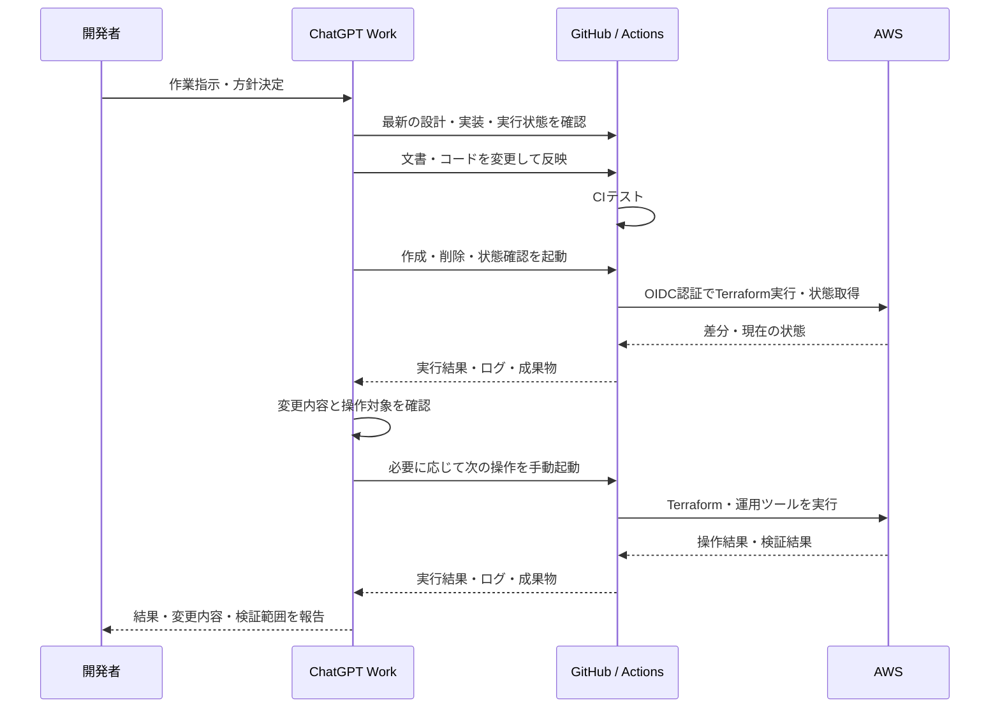

# 入館証発行管理システム

本ポートフォリオは、実際の業務システムを想定した入館証発行管理システムをAWS上に構築し、以下3点のテーマを達成するものである。

- **GitHub、Terraformを用いたIaC化およびCI/CD環境の構築**
- **AIエージェント(ChatGPT Work)を活用したAIネイティブ開発**
- **Docker等のコンテナ技術およびAWSマネージドサービスを活用した、運用負荷・可用性・信頼性を考慮したクラウドネイティブ設計**

入館証発行管理システムの要件定義・設計・実装を行い、運用手順の検証と障害復旧を実施した。

## 1. 業務・システム概要

社員の入社に伴い、ID管理システムから連携される社員情報を基に入館証番号を採番し、カード発行業者へ発行依頼を送信する。ユーザはWeb画面から社員ごとの入館証番号および発行依頼状況を参照する。

### 1.1 主要機能

| 機能 | 処理概要 |
| --- | --- |
| 社員情報受付・登録 | 社員番号・氏名・所属会社名をREST APIで受け付け、SQSを介した非同期処理により採番・DB登録を実施 |
| 入館証発行依頼 | 日次処理で対象を抽出してCSVを生成し、Transfer Family Connectorによりカード発行業者へSFTP送信 |
| 入館証発行依頼結果反映 | 転送結果をEventBridge経由で受け取り、DBの処理状態およびS3のCSV配置へ反映 |
| 入館証発行依頼状況参照 | 氏名・社員番号・入館証番号による検索、および処理状況による絞り込み |

本システムの連携完了範囲はSFTP転送完了までとし、カード発行業者による発行完了結果の連携、カードの物理発行・郵送、および退職・変更・再発行等の管理は対象外とする。

ID管理システムおよびカード発行業者はモックで再現する。Web画面はHTTPとし、画面のHTTPS・認証認可・ユーザ管理は対象外とする。

## 2. 使用技術

IaCおよびCI/CDの基盤には、**GitHub ActionsとTerraform**を使用する。AWSサービス、アプリケーション、および検証に使用する主要技術を以下に示す。

| 分類 | 使用技術 |
| --- | --- |
| IaC・CI/CD | GitHub Actions、Terraform |
| 言語・フレームワーク・DB | Python、Flask、PostgreSQL |
| コンテナ | Docker、AWS ECR |
| コンピューティング | AWS Lambda、AWS ECS / AWS Fargate、Application Auto Scaling |
| データベース | AWS Aurora PostgreSQL |
| ストレージ | AWS S3 |
| ネットワーク・API | AWS VPC、VPC Endpoint、AWS API Gateway、Application Load Balancer |
| 外部ファイル連携 | AWS Transfer Family |
| メッセージング・イベント | AWS SQS、AWS EventBridge |
| 監視・通知・費用管理 | AWS CloudWatch、AWS SNS、AWS Budgets |
| セキュリティ | AWS IAM、AWS Secrets Manager、AWS Config、AWS Security Hub、AWS GuardDuty、AWS Inspector |

詳細な配置・通信制御・サービス選定方針は、[基盤・非機能基本設計](01_ドキュメント/02_基本設計/06_基盤・非機能基本設計.md)に記載する。

## 3. 生成AI利用

ChatGPT Workを、設計、文書作成、Terraform・アプリケーション実装、テスト実行、および不具合調査に利用する。開発者が対象範囲・採用方針・重要な設計判断を決定し、合意内容を基に成果物の作成・修正を委譲する。

設計開発エージェントとレビューエージェントで役割を分けて利用し、生成結果の妥当性は、テストおよびAWS実機の証跡により検証する。

本ポートフォリオでは、**AIへの作業委譲と、人による意思決定・成果物検証を組み合わせた開発管理**を実践する。採用した要件・設計・実装・検証結果はリポジトリへ記録し、判断根拠を追跡可能とする。

ChatGPT Workの選定理由および利用方針は、[共通事項](01_ドキュメント/00_共通/README.md)に記載する。

### GPTへの指示からAWS操作までの流れ

開発者がChatGPT Workへ作業を指示し、ChatGPT WorkがGitHubの最新の設計・実装・実行結果を確認する。必要な変更をリポジトリへ反映し、目的に応じたGitHub Actionsのワークフローを起動する。AWS操作は、ワークフローがOIDCで取得する一時権限を用いて実行する。

## 4. IaCおよびCI/CD環境の構築

TerraformでAWSリソースをコード化し、GitHub Actionsから作成・変更・削除を実行する。費用削減のため、VPC・ECR等を常設し、Aurora・ECS・ALB等は必要なときに作成・削除する。

**依存関係と失敗時の挙動を考慮したワークフロー設計に注力した。** LambdaのZIP生成、DockerイメージのECR登録、SFTP接続先の準備、DBマイグレーション、ECS起動を適切な順序で実行する。Terraformの依存関係管理を基本とし、処理間の制御をPythonで補完した。

これらの技術は、**開発・検証環境の費用最適化、業務都合に合わせたリリース順序の制御、定型運用の自動化**に応用できる。本ポートフォリオで自動化した範囲は主に環境の作成・変更・削除であり、詳細は[ワークフロー操作・仕様](03_ワークフロー/README.md)に記載する。

## 5. サーバレスアーキテクチャ

業務処理にLambda、コンテナ実行基盤にFargateを採用し、SQS・S3・EventBridge・Transfer Family等のマネージドサービスを組み合わせる。業務処理基盤のOS管理負荷を抑制するとともに、処理単位に応じた再試行・失敗隔離・復旧を可能とする。

API受付、非同期登録、日次送信、および転送結果反映を分離し、各処理の責任と障害時の対応範囲を明確化する。Fargateのタスク自動復旧とAuroraのフェイルオーバーにより、実行基盤・DBの障害に対応する。

Webサービスには、ALBのリクエスト数に応じてFargateタスク数を自動調整するAuto Scalingを採用している。アクセス負荷に応じたスケールアウト・スケールインを行い、安定性と費用効率の両立を図る。設定と構築時の制御は[ECS / Fargate詳細設計](01_ドキュメント/03_詳細設計/01_基盤/07_AWS_ECS_Fargate.md)に示す。

**サービスの組合せに加え、データ整合性・監視・障害復旧を含めたシステム全体の設計**を重視している。Auroraは通常のプロビジョンド構成であり、全構成をサーバレスに統一する方針ではない。要件、可用性、運用負荷、および費用を基準に各サービスを選定する。

## 6. ドキュメント

要件定義から設計・実装・検証・運用までを関連付け、**構成の説明に加え、設計意図・検証根拠・障害時の対応を確認できる資料構成**としている。

| 資料 | 記載内容 |
| --- | --- |
| [要件定義書](01_ドキュメント/01_要件定義/要件定義書.md) | 業務目的、対象範囲、機能・非機能要件 |
| [基本設計概要](01_ドキュメント/02_基本設計/01_基本設計概要.md)・[基本設計一覧](01_ドキュメント/02_基本設計/README.md) | システム構成、外部連携、処理、画面、データ、基盤、運用監視 |
| [詳細設計](01_ドキュメント/03_詳細設計/README.md) | AWS設定、アプリケーション処理仕様、構築・保守仕様 |
| [テスト資料](01_ドキュメント/04_テスト/README.md) | テスト方針、確認項目、期待結果 |
| [運用資料](01_ドキュメント/05_運用/README.md) | 監視、障害復旧、環境変更、ワークフロー実行手順 |
| [対向システム仕様](01_ドキュメント/11_対向システム/README.md) | ID管理システム・カード発行業者のモック仕様 |
| [実装資材](02_資材/README.md) | Terraform、Python、Lambda、コンテナ |
| [ワークフロー資材](03_ワークフロー/02_資材/tools/README.md) | 環境操作・状態確認・保守ツール |
| [CIテストコード](04_テスト/README.md) | AWSに接続しないワークフロー模擬実行テスト |

資料全体の参照先は[ドキュメント一覧](01_ドキュメント/00_共通/01_ドキュメント一覧.md)にまとめる。正式な情報はリポジトリを基準とし、会話上の提案と、設計・実装・実機検証の結果を区別して管理する。

## 7. 検証・環境構築

CIはPython構文、ワークフローの模擬実行、およびTerraformの書式・定義を検証する。AWSへの認証や環境変更は行わない。実行方法と確認範囲は[CIテストコード](04_テスト/README.md)に示す。

AWS環境を構築する場合は、State保存用S3バケット、GitHub ActionsのOIDCプロバイダー、および実行ロールを事前に用意する。実行ロールの信頼条件は、使用するリポジトリのmainブランチに合わせて設定する。これらの認証基盤とState保存先は、環境操作による作成・削除の対象外とする。

Repository Variablesに`AWS_ROLE_ARN`、`TF_STATE_BUCKET`、`NOTIFICATION_EMAIL`を設定し、CIの成功を確認した後、常設環境→一時環境の順に作成する。事前設定と実行手順は[ワークフロー操作・仕様](03_ワークフロー/README.md)および[操作手順](03_ワークフロー/01_ドキュメント/03_操作手順.md)に示す。

